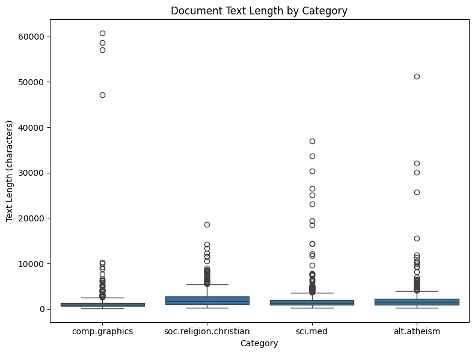
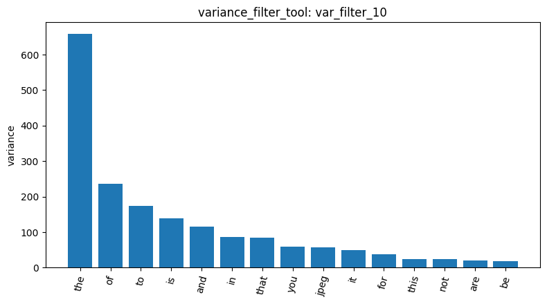
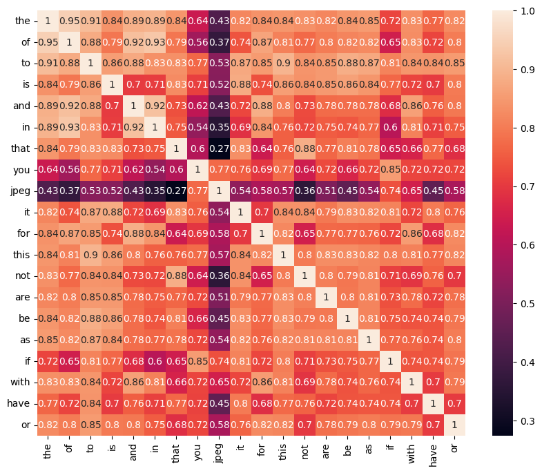
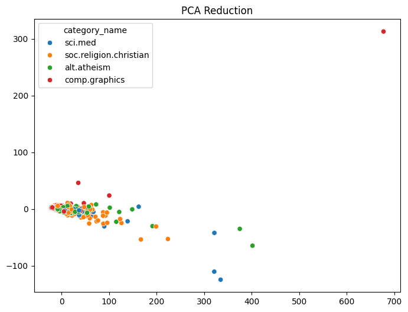

# Agentic Pipeline Report

The pipeline was executed on a subset of the 20 Newsgroups corpus, targeting four categories: *alt.atheism*, *comp.graphics*, *sci.med*, and *soc.religion.christian*. The initial corpus comprised 2,257 documents, with a relatively balanced distribution ranging from 480 to 599 entries per category (load_dataset_1). Data quality checks found no missing or empty text entries (missing_3) and no duplicate documents (duplicates_4). Descriptive statistical analysis (describe_5) reported a mean document length of 1,993 characters and a median of 1,235 characters; however, a maximum length of 60,713 characters indicates significant heterogeneity within the dataset. Cross-categorical analysis indicated variance in mean document lengths, with the soc.religion.christian category exhibiting the highest average (2,263.18 characters), as further illustrated by the distributional box plots.

For subsequent analysis, a random sample of 1,000 documents was extracted using a fixed random seed (random_state=42) to ensure reproducibility (sample_6). The resulting document-term matrix contained 22,538 unique terms with a high sparsity of 99.29% (dtm_7). Term-frequency analysis (term_freq_8) highlighted the prevalence of stop words that appear with high frequency (e.g., “the,” “to,” “of”); such words are of little use for distinguishing between topics, due to their ubiquitous distribution. The sparsity of the high-dimensional feature space is further evidenced by the DTM heatmap (dtm_heatmap_9), where the visualized 20x20 sub-matrix remains predominantly zero-valued. Feature filtering reduced the number of terms substantially. Implementation of a variance filter (var_filter_10) with a threshold of 0.01 pruned 17,779 low-variance terms, retaining a core set of 4,759 features.

Comparative analysis of Pearson correlation filtering for the *comp.graphics* category demonstrated the sensitivity of feature selection to thresholding: while a 0.0 threshold (pearson_filter_11) preserved entire 22,538 terms, a 0.1 threshold (pearson_filter_12) aggressively filtered the set to 453 terms. Additionally, inter-feature dependencies were evaluated via a correlation heatmap (feat_corr_13) for a subset of 20 terms.

Concluding the analysis, frequent pattern mining was conducted on the *comp.graphics* category using TF-IDF filtering and FP-Growth algorithm. With a minimum support threshold of 80, 103 patterns were identified (mine_patterns_14). While these results effectively captured lexical co-occurrences, the presence of header-related metadata (e.g., “writes,” “subject,” “organization”) suggests a bias toward the structure of newsgroup messages rather than semantic content. Dimensionality reduction via PCA projected the documents into a two-dimensional space, with the primary components accounting for 73.48% of the total variance (dim_reduction_15).

Finally, the pipeline implemented one-hot encoding for categorical labeling (binarize_16) and calculated a cosine similarity of 0.260023 between documents 0 and 1 (cosine_sim_17). Overall, the pipeline demonstrated how data pre-processing, feature filtering, pattern mining, dimensionality reduction, and data exploration can be combined to investigate a text dataset.