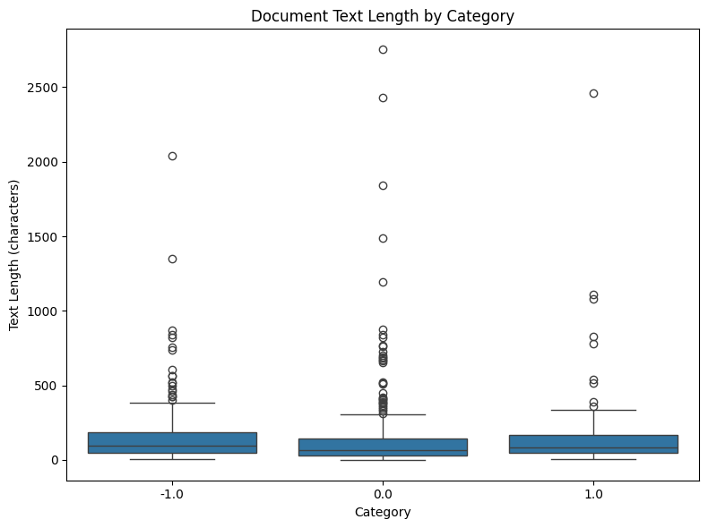
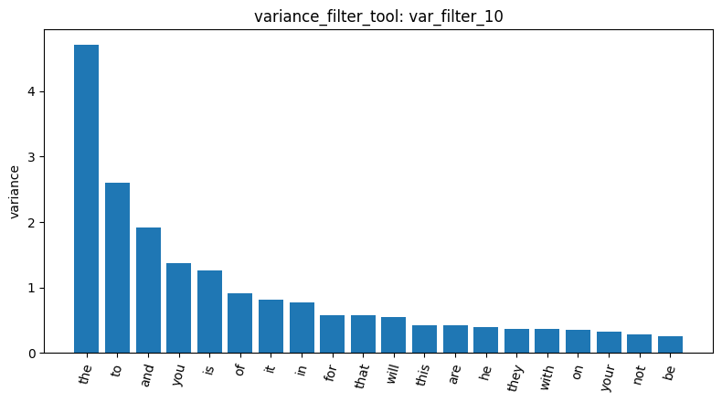
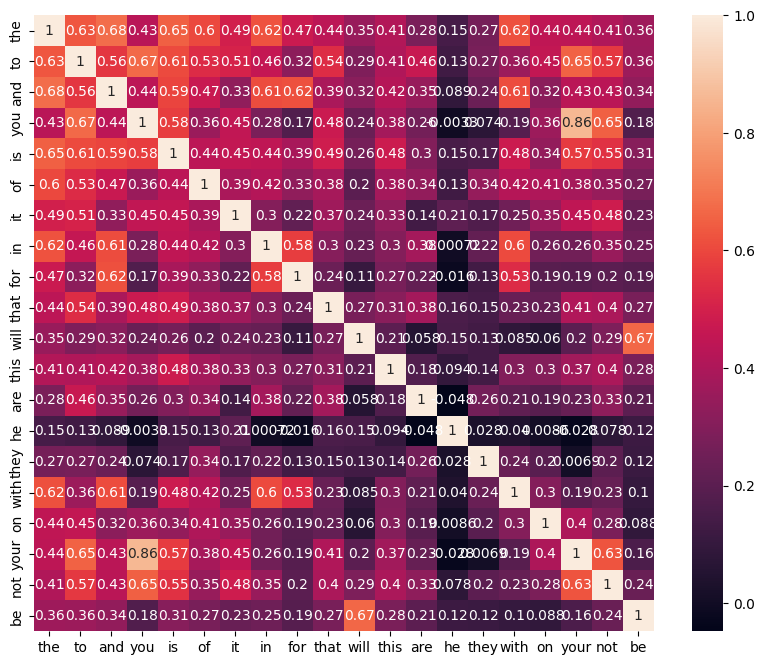
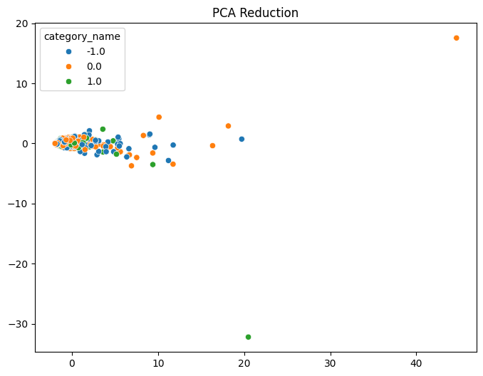
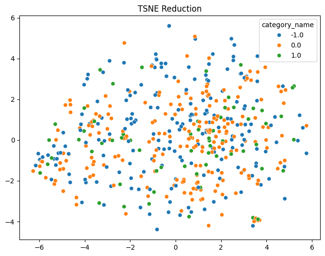

# Homework Report

The pipeline was executed on the Reddit stock sentiment dataset, containing text labeled as negative (-1.0), neutral (0.0), or positive (1.0). The initial corpus comprised 847 documents, categorized into neutral (n=423), negative (n=315), and positive (n=109) sentiment classes (load_dataset_1). Data quality checks found no missing or empty text entries (missing_3) and removed 34 duplicate documents (duplicates_4), resulting in a dataset of 813 unique documents. Descriptive statistical analysis (describe_5) reported a mean document length of 148.31 characters and a median of 80 characters, indicating that many posts were relatively short, although substantial variation was observed, with the max length of 2,753. Length distribution varied by sentiment class, with positive posts having the highest mean length (166.04 characters) and neutral posts the lowest (139.08 characters). The box plot also shows numerous unusually long posts across categories.

For subsequent analysis, a random sample of 500 documents was extracted using a fixed random seed (random_state=42) to ensure reproducibility (sample_6). The resulting document-term matrix contained 3,360 unique terms with a high sparsity of 99.35% (dtm_7). Term-frequency analysis (term_freq_8) highlighted the prevalence of stop words that appear with high frequency (e.g., “the,” “to,” “of”); such words are of little use for distinguishing between sentiments, due to their ubiquitous distribution. The DTM heatmap (dtm_heatmap_9) was entirely zero-valued for the selected slice, so it did not reveal useful patterns; this indicates that a better selection of terms would be needed for an informative visualization. Feature filtering reduced the number of terms substantially. A variance filter (threshold = 0.01) retained 474 terms while discarding 2,886 (var_filter_10).

A Pearson correlation filter targeting the positive sentiment class (threshold = 0.1) retained 363 terms and dropped 2,977 (pearson_filter_11). Note that the Pearson filter was applied to the initial 3,360-term vocabulary rather than the variance-filtered subset. Correlation matrix analysis identified strong associations between common terms (e.g., “you” and “your,” r = 0.860), likely reflecting syntactical patterns rather than sentiment-specific indicators.

Pattern mining was conducted on the positive sentiment subset using TF-IDF filtering and FP-Growth algorithm. With a minimum support of 20, no patterns were found (mine_patterns_13). Because the initial threshold produced no results, it was lowered to 5 to explore less frequent patterns. This identified 8 single-term patterns, including as “better,” “economy,” “silver” (mine_patterns_14). However, the absence of multi-term associations limits the evidence of meaningful word associations.

Dimensionality reduction was explored using both PCA and t-SNE. PCA explained approximately 33.71% of the variance in its first two components (dim_reduction_15), while its scatter plot showed a concentrated group of documents and several outliers. To better capture local neighborhood structures, t-SNE (perplexity = 30) was conducted (dim_reduction_16). The result demonstrated significant overlap across sentiment labels with no distinct clustering, suggesting that the current feature representation may be insufficient for sentiment discrimination.

Finally, cosine similarity between documents 0 and 1 was 0.0 (cosine_sim_18). This most likely means their bag-of-words vectors shared no terms after tokenization. In conclusion, while the pipeline effectively integrated multiple text mining techniques to investigate Reddit sentiment data, the findings highlight the importance of selecting informative features and interpreting visualizations thoroughly.

